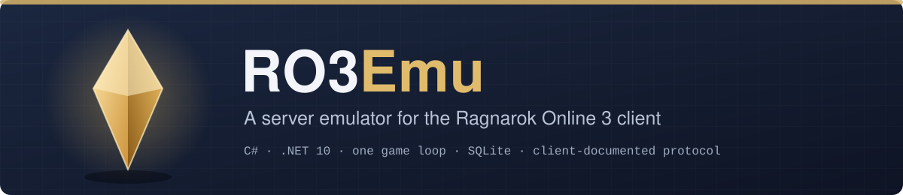
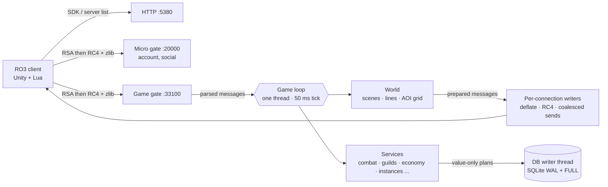

# RO3Emu — Ragnarok Online 3 server emulator

An open-source C# server emulator for the **Ragnarok Online 3 PC client**. Explore its protocol, run a local server
with data exported from your own client, or help implement and test game systems. The server uses .NET 10 and SQLite;
the client integration needs the original PC client, which this repository does not provide.

**Start here:** [Project website](https://aethai.github.io/ro3emu-server/) · [Set up a local server](#getting-started) · [See the current scope](#what-works) ·
[Browse the documentation](docs/README.md) · [Contribute](CONTRIBUTING.md) ·
[Report a bug or suggest a feature](https://github.com/aethai/ro3emu-server/issues/new/choose)

<p align="center"></p>

<p align="center">
  
  
  
  
  <a href="https://github.com/aethai/ro3emu-server/actions/workflows/ci.yml"></a>
</p>

<p align="center">
  <a href="#what-works">What works</a> ·
  <a href="#getting-started">Getting started</a> ·
  <a href="#playing-together">Playing together</a> ·
  <a href="#architecture">Architecture</a> ·
  <a href="#development">Development</a> ·
  <a href="#documentation">Documentation</a>
</p>

The PC client is a Unity (Mono) game with Lua logic. Its message table, protobuf schema, flows and config tables
provide much of this emulator's reference material. Original server behavior that the client cannot establish is
reconstructed and marked *(inferred)* in code and documentation. This is an independent project in the tradition of
Athena, eAthena, rAthena and Hercules.

---

## What works

The repository implements the areas below, with different levels of test and live-client coverage. They are an
implementation map, not a claim of complete original-server parity. See the linked system notes for inferred rules
and remaining gaps.

<table>
<tr><td valign="top" width="50%">

**World**
- SDK login, server list, both gates (RSA, then RC4 + zlib), role create / select / switch / delete
- maps, portals, NPCs, Kafra travel, map **lines** (channels) with per-map caps and line switching
- directed visibility on a grid with the client's own cap, nearest first, name boards beyond it
- monsters, spawns, MVPs, regeneration, death and revive, silent reconnect

**Combat and character**
- skills, buffs, energy, passive skills, skill growth, talents, PvP and event fights
- equipment, appraisal, affixes, enchanting, strengthening and refining, cards, emblems
- life jobs and gathering, pets (incl. tower pets), mounts, wardrobe, totems, job items (cart, falcon, Peco)
- achievements, emotes and sitting

</td><td valign="top" width="50%">

**Economy and social**
- trade center, stalls, auctions (guild, world and event), mail, NPC and point shops
- friends, parties, blacklist, chat channels, teams, adventure groups

**Guilds**
- guild management, guild home, campfire, caravan, black market, guild challenge
- **Territory Wars**: auctions, battles, escort and castle siege flows

**Instances and activities**
- dungeons, towers, matchmaking, multi-dungeons, reconstructed story dungeons and scripted story scenes
- daily activities, quests and story flows, season pages and refine, battle pass, lottery, timed events

</td></tr>
</table>

**Open content.** `Ro3Emu:OpenContent` opens supported client-visible content across server-day gates and season
windows; see its [behavior and known limits](docs/guide/open-content.md).

**Not yet:** the bar (tavern), guild voice, the chicken minigame, payments and a few niche panels. The original
server's encounter scripts are not in the client, so story dungeons and bosses are reconstructions.

## Getting started

These commands use **PowerShell on Windows**. Building the server alone needs no game files, but a playable local
setup needs your own RO3 PC client, exported game data and client hooks built against that client's DLLs.

### Prerequisites

| Software | Used for |
|---|---|
| [.NET 10 SDK](https://dotnet.microsoft.com/download/dotnet/10.0) | server, tools, tests |
| [Node.js 20+](https://nodejs.org/) | export scripts in `tools/` |
| Java 17+ and [unluac](https://sourceforge.net/projects/unluac/) (`unluac.jar` in the repository root) | decompiling the client's Lua (data export only) |
| Windows 10/11 x64 | documented client workflow and client-independent CI checks |
| The Ragnarok Online 3 PC client (`ROO_PC`) | your own copy; nothing from the game is distributed here |

Clone the repository and work from its root:

```powershell
git clone https://github.com/aethai/ro3emu-server.git
Set-Location ro3emu-server
dotnet build src/Ro3Emu.Server/Ro3Emu.Server.csproj -c Release
```

Set `RO3_CLIENT_DIR` to your client folder (the one with `ro3.exe`). The client hooks build against its managed DLLs
and several tools read its files from there:

```powershell
$env:RO3_CLIENT_DIR = 'C:\RO3\ROO_PC'
Test-Path (Join-Path $env:RO3_CLIENT_DIR 'ro3.exe') # should print True
```

### 1. Export the game data

Game data comes from your client and never goes into git (`data/` and `re/` are ignored).

```powershell
# Lua: the client's obfuscated chunks to standard Lua 5.4 bytecode, then to source
dotnet run --project tools/LuaDecode -c Release -- (Join-Path $env:RO3_CLIENT_DIR 'ro3_Data/StreamingAssets/Recovery/LuaPayload') re/clientB/luac
javac -cp unluac.jar -d tools/unluac-batch tools/unluac-batch/BatchUnluac.java
java -cp "unluac.jar;tools/unluac-batch" BatchUnluac re/clientB/luac re/clientB/lua-src

# Config tables, scene editor data, walkability grids, message names
dotnet run --project tools/ConfigExport -c Release -- re/clientB/luac data/config
dotnet run --project tools/ConfigExport -c Release -- re/clientB/luac data/sceneeditor 'Config\SceneEditor'
node tools/WorldData/navexport.js data/nav
node tools/msgtable.js re/clientB/lua-src data/msgtable.tsv
```

`data/config` holds the config tables (items, jobs, maps...), `data/sceneeditor` map points, NPCs and portals,
`data/nav` the walkability grids and `data/msgtable.tsv` the message names. Without them the server still starts but
knows no items, NPCs or maps. Check the exporter counts and `re/clientB/lua-src/_failures.tsv` before starting; the
decompiler can report failed files. Code comments cite the decompiled client as `re/clientB/lua-src/...`.

### 2. Run the server

```powershell
dotnet run --project src/Ro3Emu.Server -c Release
```

The first start creates the gate key pair (`data/gate_rsa_*.pem`) and the database (`data/ro3emu.db`). Defaults:
HTTP / SDK `5380`, micro gate `20000`, game gate `33100`, all on loopback.

### 3. Patch and start the client

```powershell
dotnet run --project src/Ro3Emu.ClientTools -- patch $env:RO3_CLIENT_DIR http://127.0.0.1:5380 data/gate_rsa_public.pem
dotnet run --project src/Ro3Emu.ClientTools -- launch $env:RO3_CLIENT_DIR
```

Originals are kept in `<client>\ro3emu-backup`; `restore <client dir>` undoes the patch. Any account name and password
works: unknown accounts are created on first login.

> [!WARNING]
> Do not run the official launcher's Verify / Repair on a patched client: it puts the original DLLs back.

**Images with baked-in Chinese text.** The hooks can swap client textures for English versions, but no images are
shipped. Render your own with `tools/ClientTextures/render.ps1` from a texture dump of your client and put the PNGs in
`src/Ro3Emu.ClientHooks/Textures/`.

## Playing together

**Server machine**

1. Set `Ro3Emu:PublicHost` in `src/Ro3Emu.Server/appsettings.json` to the address players reach (LAN or public IP
   literal) and open TCP `5380`, `20000` and `33100`. A loopback `PublicHost` binds loopback only; behind NAT forward the
   ports and keep the public IP as `PublicHost`. `Ro3Emu:BindAddress` overrides the listening interface.
2. Start it with `tools/run-server.ps1` (restarts on exit, logs to `data/logs/`). The database is backed up to
   `data/backups/` at start and every 6 hours (newest 20 kept). Who is online: `http://127.0.0.1:5380/ro3emu/online`
   (server machine only).

**Players** need the client and either the single-exe tool or a launcher:

```powershell
dotnet publish src/Ro3Emu.ClientTools -c Release -r win-x64 -o dist
$serverUrl = 'http://192.168.1.10:5380' # replace with your server's reachable address
./dist/Ro3Emu.ClientTools.exe play $env:RO3_CLIENT_DIR $serverUrl
```

`play` downloads the server's gate key, patches the client and starts it. For a real player base, host a patch
repository and hand out `Ro3Emu.Launcher` instead: it installs the client, keeps it updated and starts it
([`docs/guide/launcher.md`](docs/guide/launcher.md)).

One account is one live session: a second login kicks the older connection. The client allows one instance per machine;
`Ro3Emu.BotCli` stands in for more players when testing alone.

GM commands (`!help` in chat) are enabled per account with `Ro3Emu:GmAccounts`; with the list empty, a server started
as Production gives GM to nobody ([`docs/guide/gm-access.md`](docs/guide/gm-access.md)). Players report bugs with the
menu's Feedback button or `/bug <text>` in chat ([`docs/guide/feedback.md`](docs/guide/feedback.md)).

## Architecture



- **One game loop.** All game state is owned by one thread with a 50 ms tick; network readers only parse and enqueue.
  Await continuations come back to the loop, so services need no locks of their own. The loop drains admitted work on
  shutdown instead of dropping it.
- **Persistence off the loop.** Stores hand immutable plans to a single writer thread (one transaction per plan) and a
  small read pool.
- **Visibility.** A per-scene grid, directed views capped at the client's own limit, nearest first and rebalanced once
  a second; beyond the cap the client gets name boards. Broadcasts are serialized once and shared; compression and
  encryption stay per connection.
- **Map lines.** Public maps open a second line at the configured soft cap and close empty lines.
- **Observable load behavior.** `/ro3emu/metrics` (loopback only) exposes tick, queue, ticker and per-message costs and
  DB statements by thread and call site. `Ro3Emu.LoadTest` drives protocol bots and writes measured reports; run it
  against your own build and environment before drawing capacity conclusions.

## Development

| Path | What |
|---|---|
| `src/Ro3Emu.Server` | the server: HTTP, micro gate, game gate, game loop, services, SQLite stores |
| `src/Ro3Emu.Bot` · `Ro3Emu.BotCli` | a scripted client speaking the real protocol (tests, load, extra players) |
| `src/Ro3Emu.LoadTest` | load runner: scenarios S1-S5 with protocol bots, reports against fixed targets |
| `src/Ro3Emu.ClientTools` | patch / restore / launch the client, `play` for players, `release` for patch repositories |
| `src/Ro3Emu.ClientHooks` · `Ro3Emu.Loc` | in-client hooks (chat, Lua patches, texture swaps) and the English text layer |
| `src/Ro3Emu.Launcher` · `Ro3Emu.Patcher` | the player launcher and its content-addressed update engine |
| `tests/` | end-to-end tests: the server in-process, bots over real sockets |
| `tools/` | Lua, config, nav, proto and message-table export, localization pipeline, economy probe |
| `docs/` | guides, per-system notes and client research |

### Tests

```powershell
dotnet test tests/Ro3Emu.Patcher.Tests/Ro3Emu.Patcher.Tests.csproj -c Release
dotnet test tests/Ro3Emu.Tests/Ro3Emu.Tests.csproj -c Release --filter "Category!=Slow"
```

The patcher tests run without client data. The server integration tests start a real server on free loopback ports
and talk to it through bots, covering wire format, flow and persistence. They need the exported `data/` and are not
part of the client-independent CI check.

### Load tests

```powershell
dotnet run -c Release --project src/Ro3Emu.LoadTest -- --scenario S2 --server-local --bots 300 --duration-seconds 600 --output .loadtest/s2
```

| Scenario | What it stresses |
|---|---|
| S1 | login storm: 500 logins in 60 s |
| S2 | 300 players in one town walking and chatting |
| S3 | 500 players in a mixed economy: trade, stalls, shops, mail, gathering, towers; ledger check |
| S4 | map changes and relogs under background load |
| S5 | a full castle siege: two guilds of 80 fighting in one instance |

Each report lists every target (tick p99, reply latency, login time, players per view, DB I/O on the loop, GC, CPU,
memory) as PASS / FAIL / NOT MEASURED with the evidence.

### Contributing

Issues and pull requests are welcome. Read [CONTRIBUTING.md](CONTRIBUTING.md) for build checks, evidence rules and
what to include in a report or proposed change.

## Documentation

- [`docs/guide/`](docs/guide): running a server: GM access, open content, feedback, launcher and patch repository
- [`docs/systems/`](docs/systems): how each system is implemented and which choices are inferred
- [`docs/research/`](docs/research): client evidence behind the protocol and rules

## License

RO3Emu is free software, licensed under the [GNU General Public License v3.0](LICENSE).

## Disclaimer

RO3Emu is an independent research and interoperability project. It is not affiliated with or endorsed by Gravity or
any publisher of Ragnarok Online. It does not include or distribute the game client, its data or its art; you need
your own copy, and you are responsible for using it in line with the applicable laws and license terms. Ragnarok
Online is a trademark of Gravity Co., Ltd.
